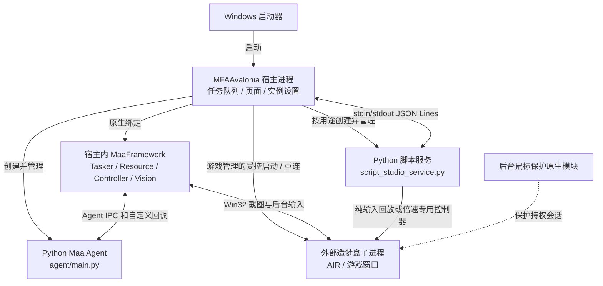
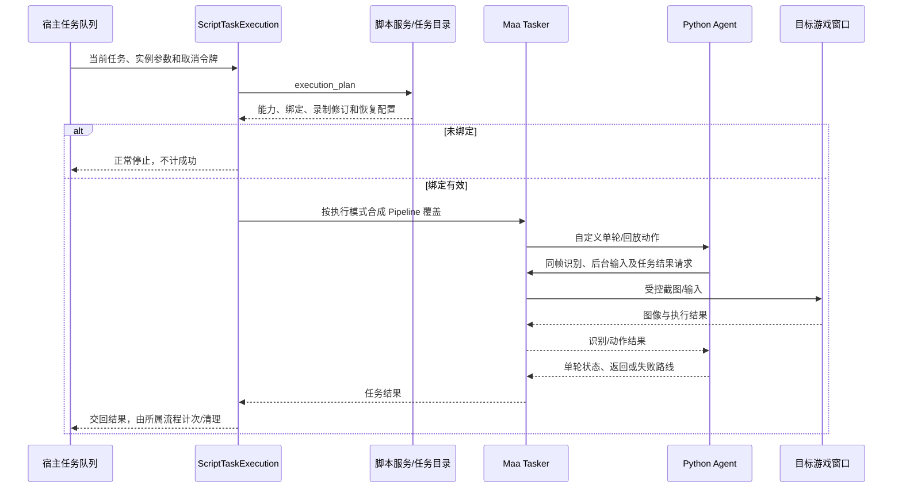
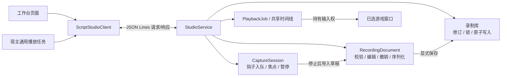
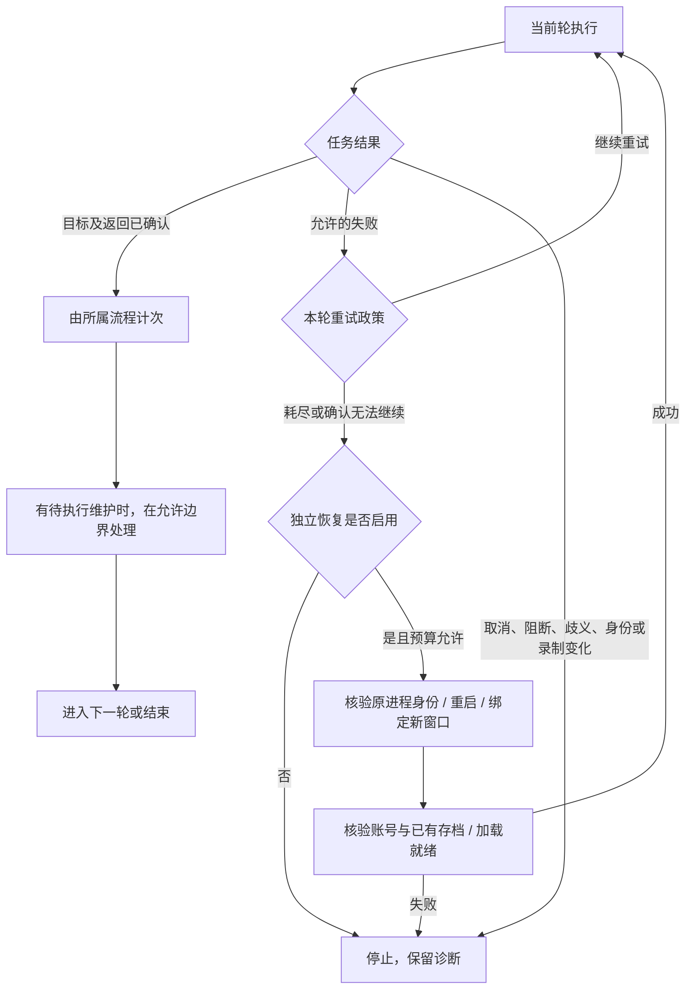
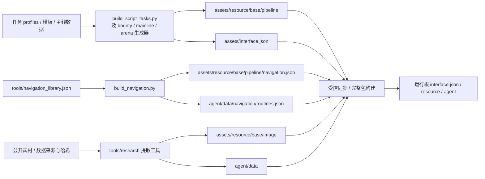
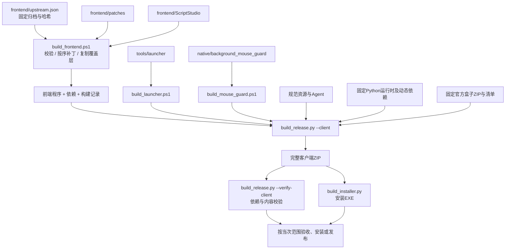

# 项目结构与执行链路

本目录保存 MAAZMXY4 的维护者结构说明，与 `agent/`、`frontend/`、`native/` 等实现目录分开。本文描述当前源码的职责、依赖和数据流；具体行为以对应实现、实例参数及测试为准，不代表已发布客户端的能力清单。

最近结构核对：2026-11-15。主线任务、竞技场、盒子倍速、游戏管理、脚本工作台与资源生成共同复用既有宿主和 Maa；性能优化调查中的拟议方案不属于当前架构。

## 1. 如何查阅与维护

- 定位入口或改动跨越多个模块时，先看第 2～4 节；涉及执行时序、协议和所有权时看第 5～7 节。
- 修改目录、模块职责、进程/协议、资源生成、数据归属或构建入口时，同步更新本文对应表格和 Mermaid 图，并与实现一同提交。
- 文件移动后更新相对链接；生成资源变化时，沿“源输入 → 生成器 → 运行读取者 → 同步/打包”复核，不只修最终 JSON。
- 用当前实现核对图中的箭头。进程创建、请求通信、数据依赖和构建复制不是同一种关系，勿混写为直接函数调用。
- 不在这里记录个人路径、账号、录制、调试日志、机器采样、临时构建目录或未执行计划。工作区布局和研究证据另在本地保存。
- 文档变更检查内容、链接和 Mermaid 语法；实现变更按第 9 节选择对应验证。本文不额外授权实机操作、安装或发布。

## 2. 源码目录地图

```text
MAAZMXY4/
├─ architecture/                  项目结构、链路及维护入口（本文）
├─ assets/
│  ├─ interface.json              项目版本、任务、选项、控制器、资源及 Agent 配置
│  └─ resource/base/
│     ├─ pipeline/                Maa 任务与识别/动作节点，部分由工具生成
│     ├─ image/                   模板图片
│     ├─ model/ocr/               OCR 模型与字典
│     └─ default_pipeline.json    项目识别默认值
├─ agent/
│  ├─ main.py                     Maa Agent 入口
│  ├─ navigation/                 有界导航、同帧识别与关卡视野恢复
│  ├─ script_studio/              纯录制模型、Windows 输入采样
│  ├─ script_studio_service.py    JSON Lines 脚本工作服务
│  ├─ script_task.py              单轮状态、导航、回放衔接、返回与计次
│  ├─ battle_player.py            Maa 自定义战斗回放动作
│  ├─ recording_playback.py       共享时间线与输入清理
│  ├─ script_playback.py          通用纯输入回放
│  ├─ battle_outcomes.py          战斗结果/浮窗监测
│  ├─ box_speed_native.py         倍速切换、确认和恢复的服务端
│  ├─ jzld/                      炼丹棋盘识别及决策
│  ├─ data/                      运行时导航、答题与百科等数据
│  └─ recordings/                经许可分发的默认模板及清单
├─ frontend/
│  ├─ upstream.json              固定宿主源码、哈希、覆盖层和补丁顺序
│  ├─ patches/                   接入固定 MFAAvalonia 的精确补丁
│  ├─ ScriptStudio/               按宿主项目布局组织的 C# / Avalonia 覆盖层
│  └─ tests/                     前端策略、协议和 headless 检查
├─ native/background_mouse_guard/  后台鼠标保护原生模块
├─ tools/
│  ├─ navigation_library.json     导航声明源
│  ├─ build_navigation.py         编译导航声明
│  ├─ build_script_tasks.py       生成共享脚本任务及扩展任务
│  ├─ mainline_tasks.py           主线与旧预设的公共定义
│  ├─ arena_tasks.py              竞技场配置生成
│  ├─ research/                  公开素材/数据提取与来源记录
│  ├─ launcher/                  Windows 启动器源码
│  ├─ installer/                 安装策略、依赖与盒子清单
│  └─ build_*.py / build_*.ps1    前端、原生模块、客户端和安装器构建
├─ tests/                        Python 逻辑、资源、原生内存控制器、Agent IPC 检查
├─ docs/zh_cn/                   使用、兼容迁移、设计和版本说明
└─ .github/workflows/            自动检查与构建入口
```

树中只列主要目录。`config/`、根 `recordings/`、根 `resource/`、`runtimes/`、`debug/`、`.runtime-cache/`、`dist/` 等通常属于运行副本、用户数据或构建产物；不能把本机恰好存在的目录当作规范源码。

## 3. 外部组件与运行进程



- [启动器](../tools/launcher/Program.cs)的正常路径直接启动同目录 `MFAAvalonia.exe`，不是通过旧更新器启动。
- MFAAvalonia 完整宿主源码来自[固定清单](../frontend/upstream.json)，本仓库保存覆盖层及补丁，不是另一份完整前端源码。
- MaaFramework 提供控制器、资源、Pipeline、识别和 Agent 传输；不要把 Maa、MFAAvalonia 和本项目资源版本合成一个版本号。
- [Maa Agent](../agent/main.py)与[脚本服务](../agent/script_studio_service.py)是两种进程职责/协议，不可互换启动参数。脚本服务可有多个所有者，并非进程名相同就可以合并或清理。
- 盒子/AIR 是外部运行组件，其来源及摘要由[盒子清单](../tools/installer/box.json)固定。本仓库不维护完整游戏引擎源码。

## 4. 主要模块职责

| 层面 | 主要入口 | 职责与边界 |
| --- | --- | --- |
| 公共配置 | [assets/interface.json](../assets/interface.json) | 当前任务、选项、默认加入策略、控制器、Agent 和资源路径；实例已保存参数在执行时覆盖 |
| 宿主接入 | [frontend/patches](../frontend/patches)、[frontend/upstream.json](../frontend/upstream.json) | 注册页面、任务入口、设备/实例生命周期、纯输入路径及手动升级策略 |
| 任务计划 | [ScriptTaskExecution.cs](../frontend/ScriptStudio/Services/ScriptTaskExecution.cs)、[TaskScriptPlan.cs](../frontend/ScriptStudio/Services/TaskScriptPlan.cs) | 查询能力和绑定、合成当前实例覆盖参数，交回既有宿主执行 |
| 目录发现 | [task_catalog.py](../agent/task_catalog.py) | 从 interface、导入定义、实例任务和 Pipeline 发现执行能力；无 UI 副本白名单 |
| 单轮任务 | [script_task.py](../agent/script_task.py) | 固定录制修订、导航、进关、回放、失败重试、返回核验和完成状态 |
| 导航 | [catalog.py](../agent/navigation/catalog.py)、[runtime.py](../agent/navigation/runtime.py)、[stage_view.py](../agent/navigation/stage_view.py) | 目标/短流程优先、相关候选、有界返回/中转；操作后帧失效，不做全库轮扫或最短路径搜索 |
| 保护识别 | [recognition.py](../agent/navigation/recognition.py)、[battle_ui.py](../agent/battle_ui.py)、[battle_outcomes.py](../agent/battle_outcomes.py) | 同帧浮窗判定、付费/复活/结果处理及歧义停止 |
| 回放 | [battle_player.py](../agent/battle_player.py)、[recording_playback.py](../agent/recording_playback.py) | 接入 Maa 动作、按绝对时间调度，停止和失败时释放持有的输入 |
| 通用播放 | [GenericScriptPlayback.cs](../frontend/ScriptStudio/Services/GenericScriptPlayback.cs)、[script_playback.py](../agent/script_playback.py) | 宿主拥有重复次数；播放阶段纯输入，不另做识图/导航/自动重启 |
| 倍速 | [NativeBoxSpeedSession.cs](../frontend/ScriptStudio/Services/NativeBoxSpeedSession.cs)、[box_speed_native.py](../agent/box_speed_native.py) | 每队列任务持有倍率会话，切换时确认，回放时同步时钟，完成清理后恢复 |
| 游戏管理 | [GameManagementService.cs](../frontend/ScriptStudio/Services/GameManagementService.cs)、[GameManagementPolicy.cs](../frontend/ScriptStudio/Services/GameManagementPolicy.cs) | 按实例管理明确目标进程、失败/内存/定时维护；在允许的任务边界恢复 |
| 恢复 | [TaskRecovery.cs](../frontend/ScriptStudio/Services/TaskRecovery.cs)、[game_management_login.py](../agent/game_management_login.py) | 预算、身份、窗口重绑、登录/已有存档核对及原轮继续，不递归重启 |
| 工作台 | [Views/Pages](../frontend/ScriptStudio/Views/Pages)、[ViewModels/Pages](../frontend/ScriptStudio/ViewModels/Pages)、[ScriptTimeline.cs](../frontend/ScriptStudio/Controls/ScriptTimeline.cs) | 脚本库、录制、时间轴和交互；页面不拥有第二个游戏任务调度器 |
| 编辑/采样 | [model.py](../agent/script_studio/model.py)、[capture.py](../agent/script_studio/capture.py) | 模型校验与编辑；钩子采样、焦点暂停和草稿。采样不发送游戏输入 |
| 用户库 | [recording_store.py](../agent/recording_store.py)、[script_library.py](../agent/script_library.py)、[recording_folders.py](../agent/recording_folders.py) | 模板首次入库、修订/锁/路径保护、绑定、分组、备份和原子写入 |
| 迁移 | [task_asset_sync.py](../agent/task_asset_sync.py)、[legacy_script_bindings.py](../agent/legacy_script_bindings.py)、[PersonalTransfer.cs](../frontend/ScriptStudio/Services/PersonalTransfer.cs) | 公共任务兼容迁移、旧绑定、个人 ZIP 预览/导入与回滚 |
| 专项任务 | [adventure.py](../agent/adventure.py)、[adventure_logic.py](../agent/adventure_logic.py)、[jzld_action.py](../agent/jzld_action.py)、[jzld](../agent/jzld) | 大冒险读题/决策、炼丹识图/决策；复用已有控制器和资源 |
| 百科/说明 | [GameDatabaseCatalog.cs](../frontend/ScriptStudio/Services/GameDatabaseCatalog.cs)、[PageTourHost.cs](../frontend/ScriptStudio/Services/PageTourHost.cs) | 离线知识数据及页面说明，不借展示行为连接游戏或启动任务 |
| 窗口/输入 | [window_geometry.py](../agent/window_geometry.py)、[mouse_input.py](../agent/mouse_input.py)、[background_mouse_guard](../native/background_mouse_guard) | 窗口身份/坐标租约、后台输入与所有者释放 |

## 5. 任务、录制与恢复链路

### 5.1 普通任务



绑定的 `pipeline` 模式只替换回放段，`replace` 模式明确替代整任务；允许的恢复边界不同。普通单轮先固定脚本哈希，失败重试仍属于同一轮，目标和返回确认后才计次；不以“回放时间走完”普遍替代任务成功。

竞技场使用共享单轮流程，并通过配置要求已观察到胜利；录制结束仍未胜利时保持失败与当前界面，不自动打开设置退关。主线旧预设复用公共入口定义，同时保留原任务标识与绑定。

### 5.2 编辑、录制与通用播放



服务先串行匹配请求与响应 ID，业务校验失败保留草稿；断线结束本次会话，不让旧响应污染新会话。录制失焦暂停，与后台回放是不同规则。通用播放的截图暂停不禁止独立的倍速切换确认阶段。

### 5.3 失败重试与恢复



挂机的无限刷取/重试与有限的进程恢复预算分属不同机制；挂机不自动开启重启。游戏管理的内存采样只负责请求维护，不能另起输入循环。恢复失败不会再次递归恢复。

## 6. 协议与所有权

| 对象 | 所有者/协作方式 | 生命周期约束 |
| --- | --- | --- |
| 宿主任务队列与重复 | MFAAvalonia 的任务执行层 | 普通原生任务与通用播放的计次归属由执行模式决定，避免双重计次 |
| Maa 自定义回调 | Resource 绑定的 Agent 通道 | 正向回调和反向 context/controller 请求保持配对；共享请求覆盖等待/读取的完整串行区间 |
| 脚本服务进程 | 创建该 ScriptStudioClient 的页面或任务服务 | 退出只清理自己创建的服务；编辑草稿与倍速恢复必须先完成对应处理 |
| 游戏进程/窗口 | 明确选择或已保存身份验证的管理会话 | 不取枚举首项；重启后核对新 PID、路径、窗口、账号及存档 |
| 输入权 | 当前回放/任务及其租约 | 录制仅采样；监测不夺输入权；取消/异常仍补释放按键和鼠标 |
| 当前帧与点击框 | 一次观察及控制器会话 | 当前帧内复用；输入、移动、重连后失效；使用新帧的目标框 |
| 预览 | 宿主截图控制器及显示订阅 | Win32 共享控制器；旧连接代次的帧不可回填；暂停显示不等于暂停任务 |
| 倍速 | NativeBoxSpeedSession | 跨任务重复持有，清理确认后才发布完成；输入与短时截图资源分开 |
| 库文件/绑定/分组 | 库锁、修订哈希、原子发布实现 | 保存保留未知字段；同名和并发变化不能覆盖；坏索引诊断而非重置 |

## 7. 数据、生成与运行副本



生成器的具体输出以代码为准；并非 `pipeline/` 下每一个文件都能由同一个生成器重建。[build_navigation.py](../tools/build_navigation.py)、[build_script_tasks.py](../tools/build_script_tasks.py)、[mainline_tasks.py](../tools/mainline_tasks.py)、[arena_tasks.py](../tools/arena_tasks.py)是主要入口。

| 数据 | 规范位置 | 运行/交付边界 |
| --- | --- | --- |
| 公共任务定义、模板、模型 | `assets/interface.json`、`assets/resource/base/` | 打包后成为根 `interface.json`、`resource/base/`；单改源码不会自动更新已安装副本 |
| Agent、导航/百科/答题数据 | `agent/`、`agent/data/` | 随包分发；不能把用户库放进 Agent |
| 默认录制模板 | `agent/recordings/manifest.json` 及获准模板 | 首次入用户库；不覆盖用户编辑，不复活用户删除项 |
| 用户录制、绑定、文件夹 | 运行根 `recordings/` | 私人数据；不提交/打包；分组索引不改变脚本内容/哈希 |
| 实例设置与布局 | 运行根 `config/`、相应布局文件 | 迁移保留已有设置和未知字段；UI展示不改长期任务设置 |
| 草稿、恢复、备份 | 对应服务和迁移模块管理的位置 | 先校验/备份，再原子写入；失败可回滚 |
| 日志与运行状态 | 运行根 `debug/` 等 | 调查证据，默认不作为公共资产 |

完整任务同步复用 [task_asset_sync.py](../agent/task_asset_sync.py) 与 [sync_task_assets.py](../tools/sync_task_assets.py)。[sync_to_runtime.py](../tools/sync_to_runtime.py)是较窄的答题资源同步工具，不是完整前端安装或全项目发布入口。

## 8. 构建与交付链



前端构建输出不等于完整客户端。`build_frontend.ps1 -Install` 只处理其管理的前端文件，不代替资源同步。源码提交、构建、安装和远端发布分别记录；通用 MFA 自动更新保持禁用，当前完整客户端采用手动升级。

构建过程按清单恢复受管宿主目标再组合补丁；不要直接修改生成缓存。新增目录 `architecture/` 是仓库维护文档，不是运行依赖；不要因为新增说明而扩大客户端的收集范围。操作细节见 [frontend/README.md](../frontend/README.md)、[迁移说明](../docs/zh_cn/个人配置备份与迁移.md)和[发布规范](../docs/zh_cn/更新协议与发布规范.md)。

## 9. 修改时的定位与验证入口

| 改动 | 先看 | 对应检查 |
| --- | --- | --- |
| 任务参数、绑定和计次 | `task_catalog.py`、`script_task.py`、`TaskScriptPlan.cs` | `test_task_catalog.py`、`test_script_round.py`、`test_script_bindings.py`、`frontend/tests/TaskOptions/` |
| 导航/模板/关卡 | 导航库、生成器、`agent/navigation/` | navigation/mainline/arena 相关测试、生成一致性、内存控制器、Agent IPC |
| 回放/结果保护 | `recording_playback.py`、`battle_outcomes.py` | playback/outcomes/round transport 测试；模拟输入不替代人工验收 |
| 游戏管理/恢复 | GameManagement/TaskRecovery 服务 | `frontend/tests/GameManagement/`、`frontend/tests/NativeRecovery/`、game_management transport |
| 编辑/录制/库 | model、capture、store、工作台页面 | studio/model/capture/library 测试、`frontend/tests/StudioPage/`、`StudioClient/` |
| 页面说明/预览 | PageTourHost、LiveViewFrameGate、宿主补丁 | `frontend/tests/PageTours/`、`LiveView/`、焦点与生命周期检查 |
| 数据迁移 | task_asset_sync、PersonalTransfer | migration/asset_sync 测试、PersonalTransfer 与 PersonalTransferUi |
| 构建/安装 | 固定清单、build_release、installer | release/installer/bundled_box 检查与包内依赖探针；范围按当次任务确定 |

原生导航通过 `NAVIGATION_NATIVE_TESTS=1` 启用，真实 Agent IPC 通过 `MAA_AGENT_NATIVE_TESTS=1` 启用；部分语料还要求显式设置素材路径。缺少依赖/语料而跳过不能记为通过。测试使用独立目录和配置，构建及验证产物放在源码/日常客户端之外。

## 10. 常见误读

- 运行根 `resource/` 不是规范 `assets/resource/`；安装副本不是源码树。
- `frontend/ScriptStudio/` 是覆盖层；旁边缓存中的完整 MFAAvalonia 源码是构建派生物。
- Maa Agent 和 JSON Lines 脚本服务不共享同一种协议；单纯并行请求可能错配响应。
- 页面、监测和预览不应另建任务输入所有者；控制器与进程必须按所有者释放。
- 导航图表示声明和有限候选，不是要恢复全图寻路/全库轮扫。
- 盒子渲染帧率、预览帧率、截图频率和回放倍率不是同一个速度参数。
- 既有源码、开发分支能力和正式 Release 能力不同；阅读发布说明判断用户实际可用功能。
